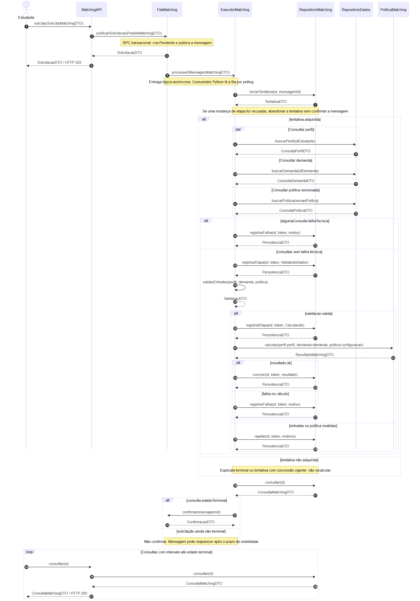
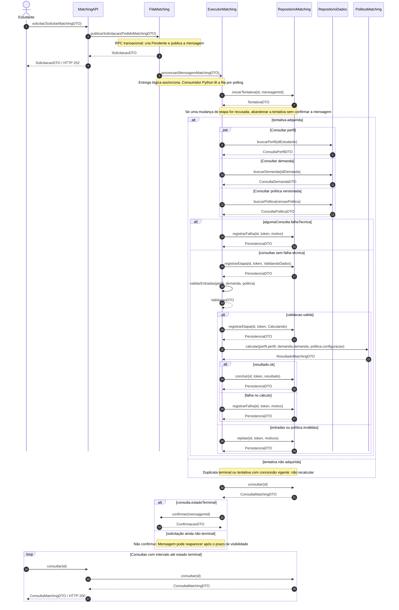
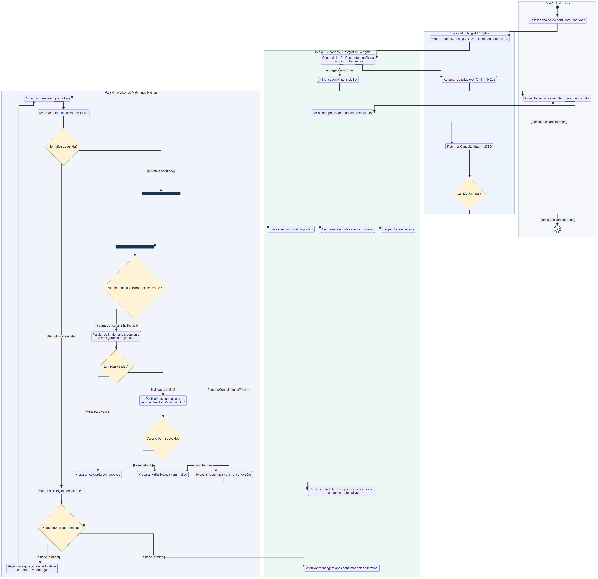
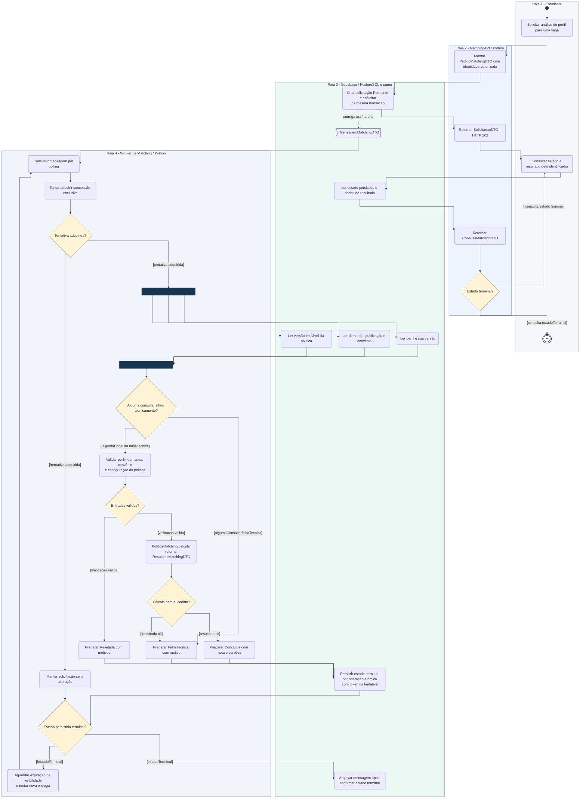
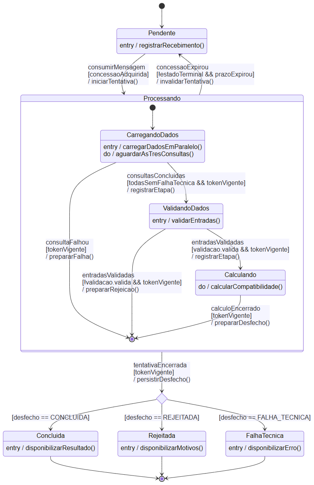
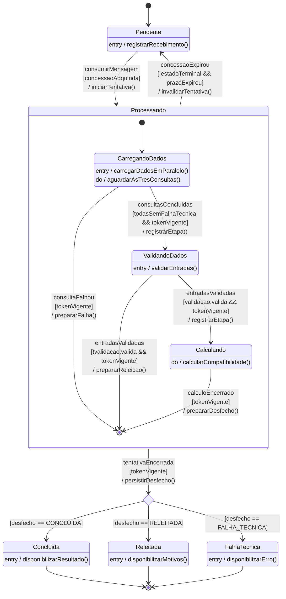
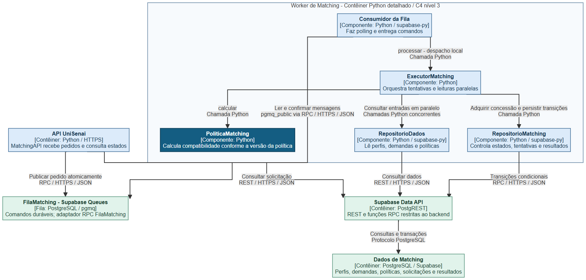
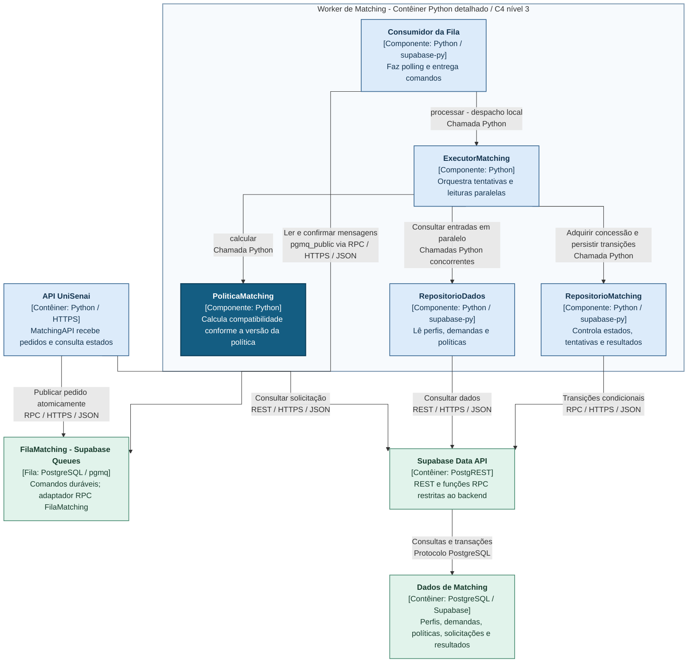
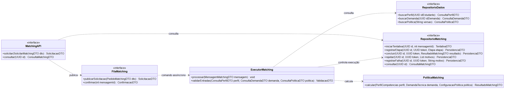
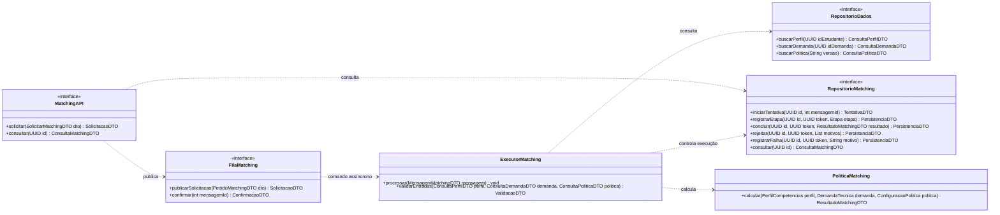

# APS 3 — PoliticaMatching

**Autor:** Lucas Gabriel de Carvalho de Oliveira  
**Projeto da equipe:** Sistema de Gestão de Aprendizagem e Estágios da UniSenai  
**Funcionalidade individual:** calcular a compatibilidade entre o perfil de competências do estudante e os requisitos de uma demanda industrial.  
**Status:** proposta de arquitetura e modelagem; não descreve uma aplicação já implementada.

## Objetivo e importância

O componente PoliticaMatching transforma informações do perfil e da vaga em uma análise rastreável de compatibilidade. Isso orienta as recomendações e reduz o cruzamento manual de dados. Esta entrega individual usa as sprints do grupo como referência de domínio e redesenha os modelos para esse recorte.

O componente recebe perfil, demanda e configuração versionada e retorna ResultadoMatchingDTO. Consultas, controle das solicitações e publicação de mensagens pertencem aos componentes de apoio. Elegibilidade acadêmica para candidatura e assinatura de contratos permanecem em outros fluxos do sistema.

## Premissas confirmadas e decisões propostas

| Tipo | Conteúdo |
| --- | --- |
| Confirmado nesta conversa | Domínio UniSenai; responsabilidade individual PoliticaMatching; Python, Supabase e Robot Framework; a equipe ainda não definiu fórmula nem pesos. |
| Herdado das sprints | Perfil de competências, demanda técnica, política de compatibilidade e convênio válido como requisito de publicação. |
| Proposto neste dossiê | SolicitacaoMatching, API e worker Python, fila durável Supabase Queues, tentativas com concessão, RPCs atômicas, DTOs e política quantitativa configurável. |
| Ainda depende de definição de negócio | Critérios exatos de similaridade, seus pesos e sua validação/aprovação. Nenhum valor foi atribuído como regra aprovada. |

## Fluxo escolhido

1. O estudante autenticado solicita uma análise para uma demanda. A API inclui a identidade autorizada no pedido.
2. Uma RPC proposta cria a solicitação Pendente e publica o comando na fila na mesma transação. A API responde HTTP 202 com SolicitacaoDTO.
3. O consumidor Python faz polling da fila e encaminha o comando ao ExecutorMatching.
4. O executor adquire uma tentativa exclusiva e consulta perfil, demanda e versão da política em paralelo, sincronizando as três respostas.
5. Dados ausentes, demanda não publicada, convênio inválido ou política incompleta produzem Rejeitada, com motivos. Falhas técnicas produzem FalhaTecnica.
6. Com entradas válidas, PoliticaMatching calcula a nota e devolve ResultadoMatchingDTO; a tentativa persiste Concluida com as versões usadas.
7. A mensagem é arquivada somente depois de confirmar um estado terminal persistido. O estudante consulta o estado e o resultado pelo identificador.

A fila transporta um comando assíncrono, embora as chamadas de leitura e confirmação usem HTTPS. Não se representa retorno HTTP como se fosse evento de conclusão. Duplicatas e consumidores atrasados não podem sobrescrever desfechos terminais.

## Regra de cálculo proposta

Como não há fórmula aprovada, o modelo exige uma política publicada contendo critérios, comparadores, pesos não negativos e versão imutável. A soma dos pesos deve ser positiva e todos os critérios habilitados devem poder ser avaliados. Dados necessários ausentes geram rejeição, sem atribuição silenciosa de zero.

Uma formulação candidata é a média ponderada normalizada:

`grau = 100 × soma(peso_i × aderencia_i) / soma(peso_i)`

Cada `aderencia_i` pertence ao intervalo de 0 a 1 e depende de um comparador definido na política. As referências de domínio são competências/área de formação, disponibilidade de carga horária e localização. A definição desses comparadores, a seleção de critérios e seus pesos continuam pendentes de decisão da equipe. A expressão é uma proposta de organização do cálculo, não uma decisão quantitativa aprovada.

A nota pertence ao intervalo de 0 a 100, acompanha a versão da política e as contribuições por critério. Ela não constitui aprovação acadêmica, autorização de candidatura ou seleção pela empresa.

## Arquitetura e responsabilidades

O C4 nível 3 detalha um único contêiner: o Worker de Matching. Consumidor, executor, política e repositórios são componentes Python internos ao worker. A API é outro contêiner Python; Supabase Data API e a fila são serviços de apoio. O PostgreSQL persiste dados e também hospeda pgmq; a fila é mostrada como abstração lógica de mensageria, não como outro fornecedor.

A seta lógica da fila para processar() na sequência resume o Consumidor da Fila. Ele lê mensagens com polling e chama o executor localmente. MatchingAPI, FilaMatching, ExecutorMatching, RepositorioDados, RepositorioMatching e PoliticaMatching possuem contratos públicos declarados nas interfaces de apoio.

## Leitura dos diagramas

- Sequência: chamadas, DTOs, entrega assíncrona, consultas paralelas, repetição e consulta do resultado.
- Atividades: quatro raias de responsabilidade; Fork/Join sincronizam perfil, demanda e política. Os pares de guardas usam expressão e negação.
- Estados: o ciclo de vida é da SolicitacaoMatching. O estado Processando tem os subestados CarregandoDados, ValidandoDados e Calculando.
- C4: responsabilidades, unidades de implantação e protocolos do fluxo.
- Interfaces: apoio para comprovar a correspondência entre mensagens e operações públicas.

O final interno de Processando representa o fim da preparação de uma tentativa, não o encerramento da solicitação inteira. Desfecho é um nó de escolha, sem persistência própria. persistirDesfecho() seleciona concluir(), rejeitar() ou registrarFalha() conforme o resultado preparado. A transição só é efetivada se sua gravação transacional tiver sucesso; falha de persistência deixa a solicitação recuperável. Os estados Concluida, Rejeitada e FalhaTecnica são terminais e imutáveis.

Na implementação proposta, estado e etapa são dois campos persistidos. A recuperação de concessão expirada é uma operação atômica que invalida o token anterior e inicia uma nova tentativa. Detalhes estão em [Contratos e DTOs](docs/contratos.md).

## Organização da entrega

Os quatro diagramas também estão disponíveis no [Mermaid Chart](docs/mermaid-links.md).

- `docs/diagrams/`: sequência, atividades, estados e interfaces em Mermaid.
- `docs/architecture/`: C4 de componentes e ADR0001.
- `docs/rendered/`: imagens PNG, SVG e relatório de renderização.
- `docs/contratos.md`: DTOs, operações, idempotência e transições condicionais.
- `docs/validacao.md`: atendimento ao enunciado e cenários de aceitação.
- `scripts/gerar_readme.py`: incorpora os códigos e a ADR neste README.
- `scripts/verificar_modelos.py`: confere operações, fontes incorporadas e correspondência dos renders.

As imagens permitem leitura imediata; os blocos Mermaid incorporados em cada seção são as fontes editáveis. Os SVGs permitem ampliar sem perder definição.

## Verificação e manutenção

Os cinco diagramas (quatro exigidos e um de interfaces de apoio) foram analisados e renderizados com Mermaid 10.9.3. A versão foi fixada para a conferência local; as imagens no README também atendem a leitores sem suporte Mermaid.

Depois de alterar uma fonte, regenere sua imagem, atualize o registro de hash no relatório de renderização e execute `python scripts/gerar_readme.py` e `python scripts/verificar_modelos.py`. Nunca atualize só a imagem: a fonte é a referência para revisão e versionamento.

Robot Framework fica reservado à automação futura dos cenários de [validação](docs/validacao.md). Não há testes de aplicação executados, API publicada ou recursos criados no Supabase por este trabalho.

## Versionamento, autoria e entrega

Esta modelagem individual adapta as abstrações do grupo ao recorte escolhido, com elaboração e revisão assistidas pelo Codex. As RPCs, interfaces e o cálculo paramétrico são especificações propostas. Os commits devem refletir mudanças reais, sem reconstrução artificial de datas ou histórico.

A entrega final requer publicar este diretório no repositório individual e enviar o link no AVA. Nenhum repositório remoto nem envio ao AVA foi realizado nesta conversa.

## Referências

- Sprint1_Grupo6.pdf: abstrações de domínio, atores e requisitos do projeto.
- sprint2.docx: escopo, fronteiras e classes conceituais. A assinatura original do cálculo foi refinada para receber configuração e devolver um DTO.
- Enunciado APS 3: Dossiê de Arquitetura Viva e Modelagem Comportamental as-Code.
- [Mermaid — sequência e setas assíncronas](https://mermaid.js.org/syntax/sequenceDiagram.html)
- [Mermaid — estados compostos](https://mermaid.js.org/syntax/stateDiagram.html)
- [Mermaid — flowcharts](https://mermaid.js.org/syntax/flowchart.html)
- [C4 Model — componentes](https://c4model.com/diagrams/component)
- [Supabase Queues](https://supabase.com/docs/guides/queues)
- [Supabase — consumo ativo da fila](https://supabase.com/docs/guides/queues/quickstart)
- [Supabase — operações de mensagens](https://supabase.com/docs/guides/queues/api)
- [Supabase Data API](https://supabase.com/docs/guides/api)

## Diagrama de sequência

[Ampliar SVG](docs/rendered/sequencia.svg) | [Fonte Mermaid](docs/diagrams/sequencia.mmd)

Código Mermaid incorporado

## Diagrama de atividades com raias

[Ampliar SVG](docs/rendered/atividades.svg) | [Fonte Mermaid](docs/diagrams/atividades.mmd)

Código Mermaid incorporado

## Diagrama de transição de estados

[Ampliar SVG](docs/rendered/estados.svg) | [Fonte Mermaid](docs/diagrams/estados.mmd)

Código Mermaid incorporado

## C4 nível 3 de componentes

[Ampliar SVG](docs/rendered/componentes.svg) | [Fonte Mermaid](docs/architecture/componentes.mmd)

Código Mermaid incorporado

## Interfaces públicas de apoio

[Ampliar SVG](docs/rendered/interfaces.svg) | [Fonte Mermaid](docs/diagrams/interfaces.mmd)

Código Mermaid incorporado

## ADR 0001 — Política de matching isolada com processamento assíncrono no Supabase

### Status

Proposto — arquitetura individual da APS 3. Python, Supabase e Robot Framework foram informados como tecnologias do projeto. A fila, o worker, o protocolo de tentativas e a formulação paramétrica abaixo são propostas deste dossiê, ainda sem implementação verificada.

### Contexto

A funcionalidade escolhida calcula a compatibilidade entre um perfil de competências e uma demanda industrial. Ela orienta recomendações, mas não autoriza candidatura nem formaliza contratos.

É necessário separar o cálculo de suas consultas e acompanhar uma solicitação enquanto ela é processada. Dados ausentes, vaga não publicada, convênio inválido, configuração incompleta e falhas de infraestrutura precisam produzir desfechos distintos e rastreáveis. A equipe ainda não definiu os pesos nem as regras quantitativas de comparação.

A APS 3 exige concorrência, mensagens assíncronas, uma máquina de estados e consistência entre operações públicas e interações.

### Decisão

1. Isolar a regra em `PoliticaMatching.calcular(perfil, demanda, politica): ResultadoMatchingDTO`. O componente não consulta banco, SGA ou assinatura; recebe dados e configuração versionados e devolve o resultado.
2. Criar a entidade `SolicitacaoMatching`, com estados Pendente, Processando (CarregandoDados, ValidandoDados e Calculando), Concluida, Rejeitada e FalhaTecnica. O estado pertence à solicitação, enquanto o cálculo é uma operação.
3. Receber solicitações por uma API Python e retornar HTTP 202 com identificador após registro e publicação duráveis. Uma função RPC proposta no PostgreSQL cria a solicitação e envia o comando à fila na mesma transação. A chave de idempotência é vinculada ao estudante e ao conteúdo do pedido.
4. Usar uma fila durável do Supabase Queues/pgmq e um worker Python, implantado separadamente da API. O consumidor faz polling e chama o executor localmente. A separação evita manter a requisição HTTP aberta enquanto o cálculo é realizado. As funções de fila necessárias precisam ser habilitadas e restritas ao backend; isso não é apresentado como configuração já existente.
5. Consultar perfil, demanda e política em paralelo, com clientes independentes ou um cliente que suporte uso concorrente. Cada ramo termina com dados ou erro tipado, com limite de espera, permitindo que o Join sempre sincronize os três resultados.
6. Persistir tentativas e transições por RPCs condicionais. Cada tentativa tem uma concessão temporária e um token exclusivo. Somente o token vigente pode avançar ou finalizar a execução. Um consumidor posterior pode recuperar concessão expirada; um consumidor atrasado não pode sobrescrever a tentativa atual. A mensagem é confirmada/arquivada apenas após a leitura de um estado terminal persistido.
7. Tratar pesos, comparadores e versão da política como configuração. Uma média ponderada normalizada é uma formulação proposta, descrita no README; não há pesos, critérios de corte ou valores de similaridade aprovados. Sem política publicada e completa, a execução termina como Rejeitada, sem nota.
8. Usar Robot Framework na futura automação dos cenários descritos em `docs/validacao.md`. A entrega atual é o dossiê de modelagem.

API e worker acessam o Supabase por HTTPS/JSON, REST e RPC; os módulos internos usam chamadas Python. A integração com o SGA e a assinatura eletrônica permanece fora deste recorte.

### Consequências

#### Benefícios

- O algoritmo pode ser revisto ou testado sem acoplamento à persistência e ao transporte.
- As consultas independentes podem ocorrer em paralelo.
- O solicitante recebe um identificador para acompanhar o processamento.
- As versões do perfil, da demanda e da política ficam associadas ao resultado.
- Transições condicionais e tokens de tentativa impedem alterações por consumidores obsoletos.

#### Custos e riscos aceitos

- A arquitetura passa a exigir um processo worker, fila, monitoramento e política de recuperação de concessões.
- Polling introduz intervalo entre publicação, execução e visualização do resultado.
- Reentregas são possíveis fora da janela de visibilidade; idempotência e controle de concorrência continuam necessários.
- Publicação atômica e transições protegidas exigem funções PostgreSQL adicionais, ainda a implementar.
- Leituras paralelas não formam automaticamente um snapshot transacional único. O resultado registra as versões efetivamente lidas e representa uma análise daquele conjunto de entradas; candidatura deve revalidar as regras atuais.
- O serviço depende do Supabase. Permissões, limites de espera, visibilidade da mensagem e duração da concessão precisam ser configurados e monitorados.
- O cálculo quantitativo permanece condicionado à definição e aprovação da política pela equipe.

### Alternativas consideradas

- **Cálculo inteiramente síncrono:** menor custo operacional, porém mantém o cliente aguardando e não atende à proposta assíncrona deste fluxo.
- **Fila de fornecedor adicional:** possível, mas acrescentaria outra tecnologia à stack. A proposta usa a fila nativa da plataforma já escolhida.
- **Regra dentro da interface ou do repositório:** dispersa a responsabilidade do cálculo e dificulta sua validação isolada.

### Referências

- [Supabase Queues](https://supabase.com/docs/guides/queues)
- [Consumo por polling e exposição das funções](https://supabase.com/docs/guides/queues/quickstart)
- [API de fila: read e archive](https://supabase.com/docs/guides/queues/api)
- [Supabase Data API](https://supabase.com/docs/guides/api)
