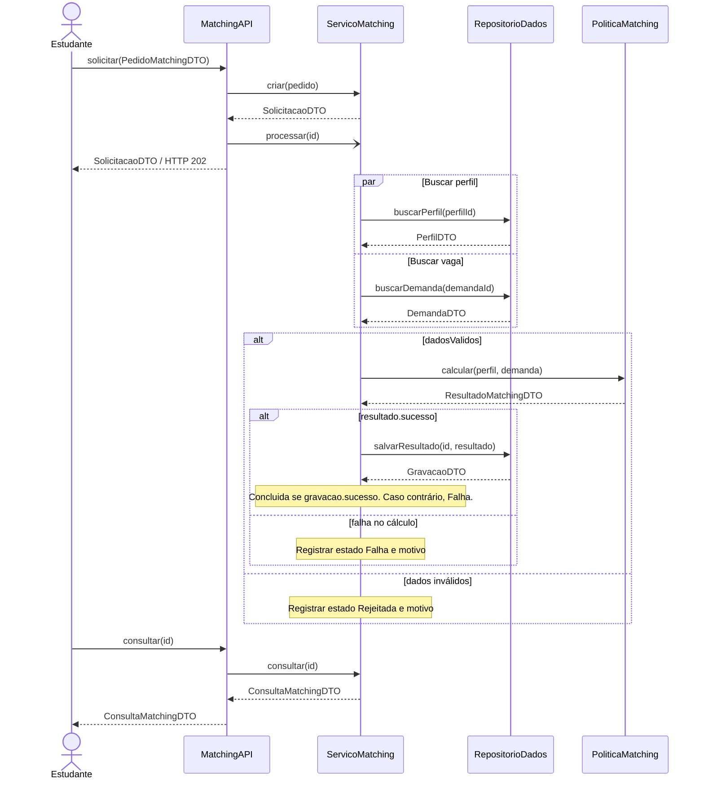
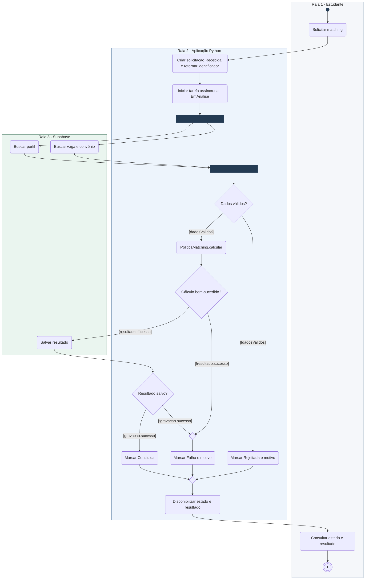
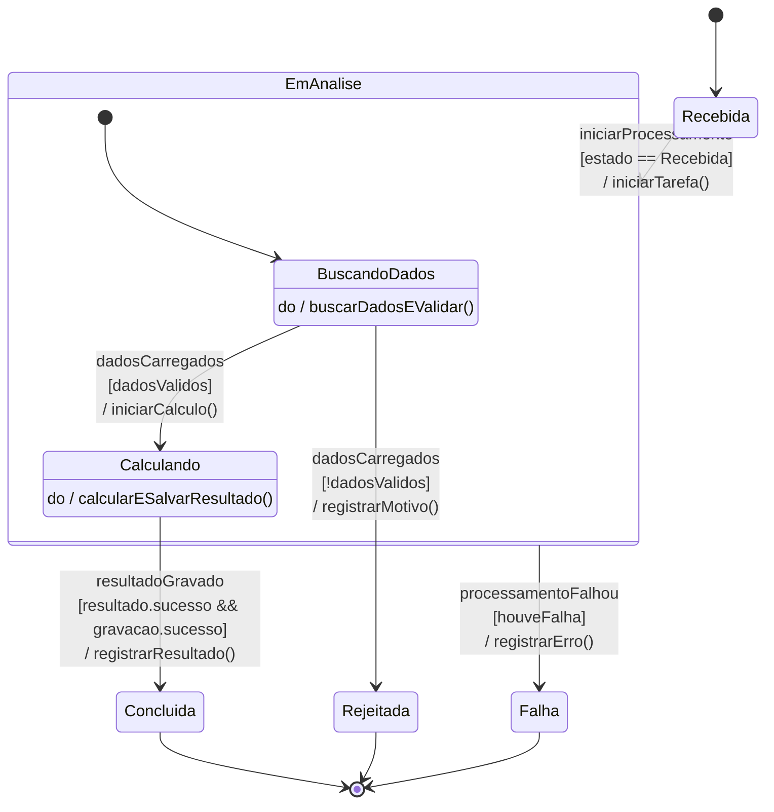
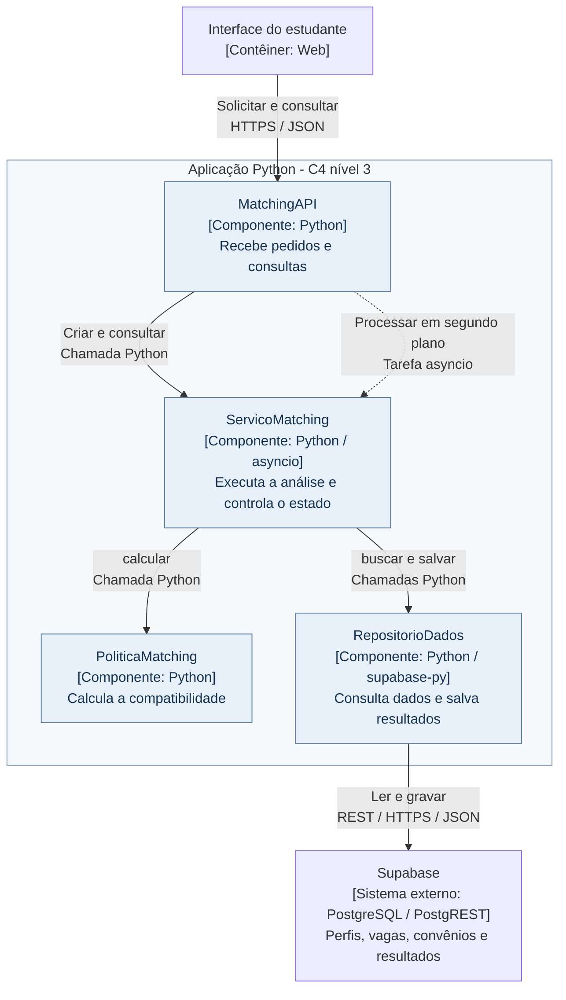

# APS 3 — PoliticaMatching

**Aluno:** Lucas Gabriel de Carvalho de Oliveira  
**Projeto:** Sistema de Gestão de Aprendizagem e Estágios da UniSenai.

## Funcionalidade

Calcular a compatibilidade entre o perfil do estudante e os requisitos de uma vaga industrial. A análise orienta as recomendações de vagas.

A aplicação Python recebe o pedido, inicia uma tarefa assíncrona e permite consultar seu estado. Perfil e vaga são buscados em paralelo no Supabase. Com dados válidos, PoliticaMatching calcula a compatibilidade e o resultado é salvo.

`dadosValidos = perfil.encontrado && demanda.encontrada && demanda.publicada && demanda.convenioValido`

O serviço inicia o processamento somente no estado Recebida. Cada solicitação possui uma única tarefa; os estados Concluida, Rejeitada e Falha não aceitam novas alterações. Erros técnicos são capturados pela tarefa e levam ao estado Falha. Falhas reportadas pelo cálculo ou pela gravação também levam a Falha.

Os critérios de comparação e seus pesos ainda serão definidos pela equipe. Os diagramas representam o fluxo do cálculo, sem atribuir pesos ou uma fórmula como regra aprovada.

## Tecnologias

- Python: API, tarefa assíncrona com asyncio e regra de matching.
- Supabase: consulta de perfis e vagas e armazenamento de resultados.
- Robot Framework: tecnologia prevista para testes; esta atividade entrega a modelagem.

## Operações públicas

Assinaturas das classes utilizadas no diagrama de sequência:

```python
class MatchingAPI:
    def solicitar(self, pedido: PedidoMatchingDTO) -> SolicitacaoDTO: ...
    def consultar(self, id: str) -> ConsultaMatchingDTO: ...

class ServicoMatching:
    def criar(self, pedido: PedidoMatchingDTO) -> SolicitacaoDTO: ...
    async def processar(self, id: str) -> None: ...
    def consultar(self, id: str) -> ConsultaMatchingDTO: ...

class RepositorioDados:
    async def buscarPerfil(self, perfilId: str) -> PerfilDTO: ...
    async def buscarDemanda(self, demandaId: str) -> DemandaDTO: ...
    async def salvarResultado(self, id: str, resultado: ResultadoMatchingDTO) -> GravacaoDTO: ...

class PoliticaMatching:
    def calcular(self, perfil: PerfilDTO, demanda: DemandaDTO) -> ResultadoMatchingDTO: ...
```

## Dados retornados

| DTO | Conteúdo |
| --- | --- |
| PedidoMatchingDTO | perfilId e demandaId |
| SolicitacaoDTO | id e estado |
| PerfilDTO | encontrado e dados de competências, formação, disponibilidade e localização |
| DemandaDTO | encontrada, publicada, convenioValido e requisitos da vaga |
| ResultadoMatchingDTO | sucesso, grau de compatibilidade e motivo de falha, quando houver |
| GravacaoDTO | sucesso |
| ConsultaMatchingDTO | id, estado, resultado e motivo, quando houver |

## Diagrama de sequência



## Diagrama de atividades com raias



## Diagrama de estados



## C4 nível 3 de componentes



## ADR0001

### ADR 0001 — Separar o cálculo de matching das consultas aos dados

#### Status

Proposto.

#### Contexto

O sistema precisa comparar o perfil do estudante com os requisitos da vaga. A regra de cálculo deve poder mudar sem alterar as consultas ao Supabase. A equipe ainda não definiu os critérios quantitativos nem seus pesos.

#### Decisão

Manter o cálculo em um componente Python chamado PoliticaMatching. O ServicoMatching busca perfil e vaga em paralelo, valida os dados e chama a política.

A API inicia uma tarefa em segundo plano com asyncio e retorna o identificador da solicitação. O estado é acompanhado em memória pelo serviço. O RepositorioDados usa a API REST do Supabase por HTTPS/JSON para consultar as entradas e salvar o resultado.

O processamento só começa no estado Recebida. Somente uma tarefa é responsável por cada solicitação, e estados terminais não podem ser alterados.

#### Consequências

- A regra de cálculo fica separada do acesso ao banco.
- A interface pode consultar o estado enquanto o processamento ocorre.
- A solução utiliza uma aplicação Python e Supabase.
- Uma reinicialização da aplicação pode perder as tarefas e os estados em memória; nesse caso, o estudante precisa solicitar uma nova análise.
- Os critérios e pesos ainda precisam ser definidos pela equipe.
